<div align="center">

# CareLoop 🩺
### Post-Discharge Recovery & Patient Safety Guardian

[](https://shaunjee.github.io/CareLoop/)
[](LICENSE)
[](test_runner.js)
[](test_runner.js)
[](index.html)

<br/>

**DSH Hacks V2 Submission · Theme: AI x Healthcare**  
*Turning confusing hospital discharges into safe, multilingual recovery plans.*

[**🚀 Launch Interactive Demo**](https://shaunjee.github.io/CareLoop/) · [**📄 Executive Summary (PDF)**](submission_deliverables/CareLoop_OnePager.pdf) · [**💻 Source Code (PDF)**](submission_deliverables/CareLoop_Source_Code.pdf)

</div>

---

> **The One-Line Pitch:**  
> **CareLoop turns a confusing hospital discharge into a safe, understandable recovery plan in your own language, and watches the first 30 days so a family and a doctor know before things go wrong.**

---

## 🌟 Clinical Problem & Motivation

The days immediately following hospital discharge are among the most dangerous windows in modern medicine:

- **1 in 5 Medicare Patients** (19.6%) are readmitted within 30 days (*Jencks et al., NEJM*).
- **Over 50% of adult patients** experience at least one medication error or discrepancy post-discharge (*Kripalani et al., JAMA*).
- **The Health Literacy Gap:** Discharge summaries are written in compressed, clinical jargon (`LVEF 35%`, `TCA Meds`, `OD mane`). Vulnerable patients and family caregivers leave with little comprehension of what changed in their medications, which warning signs matter, or when to seek urgent help.
- **Silent Outpatient Deterioration:** Heart failure fluid congestion and post-surgical wound infections creep up quietly over 72 hours. Without remote outpatient surveillance, the patient only returns once they are in critical distress.

**CareLoop** bridges this dangerous gap with an offline-first, multilingual platform combining an **AI translation & parsing layer** with a **deterministic clinical rules engine**.

---

## 🔄 The Four Continuous Care Loops

```mermaid
flowchart TD
    Discharge["🏥 &nbsp;&nbsp; <b>HOSPITAL DISCHARGE</b> &nbsp;&nbsp;•&nbsp;&nbsp; <i>Unstructured Clinical Notes & Complex Medication Regimens</i> &nbsp;&nbsp; 🏥"]

    subgraph CareLoops ["<b>CONTINUOUS OUTPATIENT CARE & SAFETY SURVEILLANCE</b>"]
        direction TB
        subgraph Row1 [" "]
            direction LR
            L1["🔍 <b>LOOP 1 · DECODE (Clinical NLP Parser)</b><br/>• Decodes medical shorthand into actionable care plans<br/>• <b>6 Global Languages:</b> English · Español · 中文 · Français · Melayu · தமிழ்<br/>• <b>Dual Modes:</b> Simple Everyday ⟷ Standard Clinical ICD-10"]
            L2["🛡️ <b>LOOP 2 · PROTECT (Medication Guardian)</b><br/>• Visual dosing timeline with daily adherence streak ring<br/>• Pre-ingestion check stops lethal prescription & OTC clashes<br/>• Intercepts <b>Triple Whammy</b> acute renal failure before ingestion"]
        end
        subgraph Row2 [" "]
            direction LR
            L3["⏱️ <b>LOOP 3 · WATCH (60s Check-in & Rules Engine)</b><br/>• Daily biometric surveillance: Weight, BP, Dyspnea & Edema<br/>• Explainable <b>0–100 Recovery Risk Index</b> with factor attribution<br/>• <b>Time Machine:</b> Simulates recovery to catch silent decompensation"]
            L4["👨‍👩‍👧 <b>LOOP 4 · CONNECT (Caregiver & Clinician SBAR)</b><br/>• Real-time automated SMS alerts dispatched to family caregivers<br/>• <b>Caregiver Read-Only Pass:</b> Cryptographic QR pass for instant, secure family surveillance<br/>• One-tap standardized <b>SBAR brief</b> ready for doctor review/print<br/>• <b>Universal Safety Net:</b> Red 'I Feel Unwell' 911/112/999 paramedic card"]
        end
        Row1 ==> Row2
    end

    Outcome["🎯 &nbsp;&nbsp; <b>SAFE 30-DAY OUTPATIENT RECOVERY</b> &nbsp;&nbsp;•&nbsp;&nbsp; <i>Avoidable Hospital Readmissions Intercepted Early</i> &nbsp;&nbsp; 🎯"]

    Discharge ==> Row1
    Row2 ==> Outcome

    style Discharge fill:#0F5C5A,stroke:#093B3A,stroke-width:2px,color:#FFFFFF
    style Outcome fill:#0F5C5A,stroke:#093B3A,stroke-width:2px,color:#FFFFFF
    style CareLoops fill:#F7FAF9,stroke:#0F5C5A,stroke-width:1.5px,stroke-dasharray: 4 4
    style Row1 fill:transparent,stroke:transparent
    style Row2 fill:transparent,stroke:transparent
    style L1 fill:#E6F4F1,stroke:#0F5C5A,stroke-width:2px,color:#1D2A29
    style L2 fill:#EBF5EA,stroke:#2E7D32,stroke-width:2px,color:#1D2A29
    style L3 fill:#FFF4E5,stroke:#E65100,stroke-width:2px,color:#1D2A29
    style L4 fill:#EDE7F6,stroke:#512DA8,stroke-width:2px,color:#1D2A29
```



---

## 🛡️ Safety-First Hybrid Architecture

CareLoop adheres to a strict clinical engineering principle:

> [!IMPORTANT]
> **The AI Layer Understands & Explains · The Rules Engine Decides**  
> - **AI / NLP Layer:** Handles natural language parsing, medical abbreviation expansion, and multilingual translation.
> - **Deterministic Rules Engine:** **100% of clinical safety decisions**, drug-drug interactions, emergency alerts, and risk levels are computed in auditable deterministic code.
> - **Zero Hallucination Tolerance:** The AI layer can **NEVER** lower a risk score, suppress an emergency flag, or alter prescribed medication dosages.
> - **Universal Safety Net:** A persistent red *"I Feel Unwell"* button is accessible from every screen, instantly displaying 911 / 112 / 999 global emergency calling and an unmissable paramedic handover card listing active diagnoses and current drugs.

---

## 🚀 Key Prototype Features

| Feature | Description | Clinical Rationale |
| :--- | :--- | :--- |
| **Discharge Decoder** | Ingests clinical text with a 68-drug dictionary. Global 6-language engine (**English, Español, 中文, Français, Bahasa Melayu, தமிழ்**) + Dual Reading Modes (**Simple Everyday ⟷ Standard Clinical ICD-10**). | Eliminates language and health literacy barriers for patients while preserving ICD-10 GDMT depth for clinicians. |
| **Global Personas** | Interactive demo personas headed by **Robert Miller** (Heart Failure & HTN · Boston, MA · English default), alongside Pak Ahmad, Mdm Tan, and Priya. | Demonstrates global applicability across diverse patient demographics and clinical profiles. |
| **Source-Span Highlighting** | Hovering over any care plan card highlights the exact source lines in the primary hospital text. | Builds trust with patients and clinicians via full provenance. |
| **Medication Guardian** | Timeline scheduler with adherence tracking + 32-row interaction matrix catching prescription & OTC clashes. | Prevents accidental double-dosing and fatal drug interactions (*e.g., Triple Whammy*). |
| **Time Machine** | Interactive day-by-day simulator fast-forwarding recovery from Day 0 baseline to Day 3 clinical deterioration. | Demonstrates how the system catches decompensation before readmission. |
| **Caregiver Circle & Read-Only Pass** | Scannable cryptographically-signed offline QR pass (`/pass/<token>`) giving family members instantaneous read-only dashboard access to recovery risk index, morning vitals, and medication adherence without requiring login credentials. | Keeps family caregivers in the loop without app friction while safeguarding clinical record modification integrity. |
| **Clinician SBAR Brief** | One-tap handover brief in standard medical format (*Situation, Background, Assessment, Recommendation*) with A4 print styling. | Saves doctor time during outpatient reviews. |
| **Live Trust Panel** | On-device test runner executing 20 synthetic summaries (15 tuning + 5 held-out) and 30 clinical rule cases. | Zero fabricated metrics: all accuracy numbers are live. |

---

## 🧪 Verified Test Results

| Test Dimension | Scope | Result | Status |
| :--- | :--- | :--- | :--- |
| **Discharge Parser (Tuning Set)** | 15 synthetic summaries | **100.0% Precision · 100.0% Recall · 100.0% F1** | **PASS ✓** |
| **Discharge Parser (Held-Out Set)** | 5 unseen summaries | **100.0% Precision · 100.0% Recall · 100.0% F1** | **PASS ✓** |
| **Dose Preservation Fidelity** | Extracted dosage strings | **100.0% Exact Match Rate** | **PASS ✓** |
| **Deterministic Rules Engine** | 30 clinical test cases | **30 / 30 Cases Passing (100%)** | **PASS ✓** |
| **XSS & Injection Protection** | String sanitization | **100% Escaped via `escapeHtml()`** | **PASS ✓** |

To execute the test suite yourself:
```bash
node test_runner.js
```
*(Or open the interactive app with `?test=1` appended to the URL to view the live evaluation suite in the browser console).*

---

## 💻 Running the App

CareLoop is built as a single, self-contained web application with **zero frameworks, zero build steps, and zero external runtime dependencies**. It works completely offline.

### Option 1: Live Demo (No Setup Needed)
Visit the deployed application directly:  
👉 **[https://shaunjee.github.io/CareLoop/](https://shaunjee.github.io/CareLoop/)**

### Option 2: Run Locally
```bash
# Clone the repository
git clone https://github.com/ShaunJee/CareLoop.git
cd CareLoop

# Launch with any local server (Python example)
python -m http.server 8000

# Or using Node.js
npx serve .
```
Then open `http://localhost:8000` in your web browser. You can also simply double-click `index.html` to open it directly.

---

## 📁 Repository Structure

```text
CareLoop/
├── index.html                   # 🚀 Root interactive web application (runs GitHub Pages & local)
├── prototype/
│   └── index.html               # 📱 Prototype codebase (offline-first single-page app)
├── submission_deliverables/     # 🏆 Official Hackathon Deliverables
│   ├── CareLoop_OnePager.pdf    # One-page executive summary PDF for judges
│   └── CareLoop_Source_Code.pdf # Full syntax-highlighted code PDF with TOC & line numbers
├── tests/
│   └── test_runner.js           # 🧪 Automated test runner (F1 parser test, 30 rules cases, XSS check)
├── test_runner.js               # ⚡ Root test runner shortcut
├── LICENSE                      # 📜 MIT License
└── README.md                    # 📖 Project documentation & architecture guide
```

### Official Deliverable Links:
- **Interactive App:** [index.html](index.html)
- **One-Pager PDF:** [CareLoop_OnePager.pdf](submission_deliverables/CareLoop_OnePager.pdf)
- **Source Code PDF:** [CareLoop_Source_Code.pdf](submission_deliverables/CareLoop_Source_Code.pdf)
- **Test Suite:** [test_runner.js](test_runner.js)

---

## 🔒 Safety, Ethics & Limitations

- **Clinical Decision Support Only:** CareLoop is an informational Clinical Decision Support System (CDSS) designed to empower patient self-care and family vigilance. It is **not** an autonomous diagnostic medical device.
- **Synthetic Patient Data:** All patient names, case histories, and hospital summaries used in this demonstration are strictly synthetic and fictional.
- **Clinician-Configured Thresholds:** Default rules thresholds (e.g. weight gain ≥ 2kg in 3 days) are illustrative defaults derived from published heart failure self-care guidelines and must be customized by the treating physician.
- **Translation Quality:** The bundled translations (Bahasa Malaysia, Chinese, Tamil) demonstrate localization capability; production clinical deployment requires certified medical translator validation.

---

## 🗺️ Product Roadmap

- **Phase 1 (Hackathon MVP - Complete):** Zero-dependency offline client, 68 drugs, 32 interactions, 4 languages, Time Machine, SBAR generator, and live test harness.
- **Phase 2 (Hospital EHR Integration):** SMART-on-FHIR connector to ingest real discharge summaries directly from Cerner and Epic EHRs.
- **Phase 3 (Cellular IoT Vitals):** Direct integration with cellular-connected weight scales and blood pressure cuffs for non-tech-savvy elderly patients.
- **Phase 4 (Community Clinic Pilot):** Prospective feasibility validation trial measuring 30-day readmission reduction in chronic heart failure cohorts.

---

## 📜 License
CareLoop is released under the **[MIT License](LICENSE)**.
